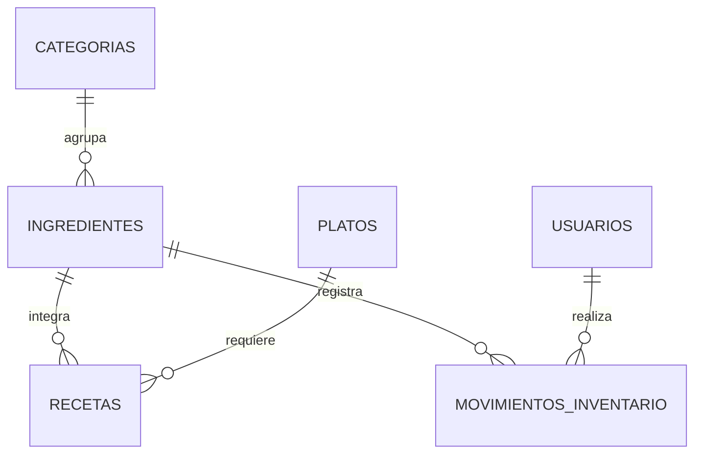

# Mesa Clara

Sistema de cocina e inventario desarrollado con **Python 3.14.8**, Flask, **SQLAlchemy ORM 2.1.4**, Flask-SQLAlchemy, Flask-Migrate, Flask-Login, Flask-WTF, SQLite y Bootstrap 5.

La interfaz y los flujos son propios. El [repositorio compartido](https://github.com/XIAC/reposteriaconplantilla) se revisó como referencia de estructura; el punto de partida fue cookiecutter-flask. Los modelos usan `DeclarativeBase`, `Mapped`, `mapped_column`, `relationship` y consultas `select()` siguiendo la [guía ORM de SQLAlchemy 2.1](https://docs.sqlalchemy.org/en/21/orm/quickstart.html).

## Iniciar en macOS

Desde la carpeta del proyecto:

```bash
source .venv/bin/activate
npm start
```

Abre **http://127.0.0.1:5000** y selecciona **Crear cuenta**. Elige tu usuario y contraseña (mínimo 8 caracteres). Luego inicia sesión.

No se crearon cuentas ni contraseñas predefinidas. Todas las cuentas trabajan sobre la misma cocina compartida; la autenticación es sencilla y no incluye roles de administración.

Para detener el servidor y Webpack, usa `Ctrl+C` en la terminal. Si el puerto está ocupado:

```bash
FLASK_RUN_PORT=5002 npm start
```

Python está instalado dentro de `.python/` y el entorno virtual en `.venv/`. Si mueves el proyecto a otra ruta, recrea el entorno virtual.

## Qué puedes hacer

- Crear y editar categorías; activarlas o desactivarlas.
- Gestionar ingredientes, unidades, costo, stock mínimo y vencimiento.
- Buscar ingredientes y filtrar por categoría, stock bajo o vencimiento.
- Crear platos y definir sus ingredientes y cantidades por porción.
- Consultar el costo de una receta y el precio de venta del plato.
- Registrar entradas y salidas con motivo, fecha y usuario responsable.
- Registrar una preparación de una o más porciones, descontando sus ingredientes.
- Revisar stock bajo, vencimientos y movimientos recientes.

Se cargó un **catálogo ilustrativo** de 3 categorías, 6 ingredientes y 2 recetas. Su stock comienza en cero y los precios son ejemplos editables. El comando opcional `flask seed-demo` crea ese catálogo únicamente si está vacío; no reemplaza datos existentes.

### Primer recorrido

1. Crea tu cuenta e inicia sesión.
2. Revisa las categorías y los ingredientes de la despensa, o crea los tuyos.
3. En **Registrar movimiento**, elige un ingrediente y registra una **Entrada**.
4. Repite las entradas para los ingredientes de un plato.
5. Abre **Platos y recetas**, entra en una receta y registra las porciones que vas a preparar.
6. Revisa el stock actualizado y las salidas del historial.

Las cantidades siempre se expresan en la unidad del ingrediente. Por ejemplo, `0.125 kg` equivale a 125 gramos; la aplicación no hace conversiones automáticas. La unidad no se puede cambiar cuando ya hay recetas o movimientos que la usan.

Las preparaciones son atómicas: si falta un ingrediente, está vencido o está inactivo, se revierte toda la operación. Ninguna salida puede dejar stock negativo. Los ingredientes nuevos parten de cero y las cantidades cambian solo mediante movimientos registrados. Los movimientos no se editan ni eliminan; para corregirlos, registra un movimiento compensatorio con su motivo.

Los registros se desactivan en lugar de eliminarse, conservando las relaciones y el historial. Desactivar una categoría también impide usar sus ingredientes. Se permite sacar stock vencido para registrar una merma, pero no ingresarlo ni usarlo en una preparación. El vencimiento corresponde al ingrediente completo, sin manejo de lotes.

## Modelo de datos

El modelo sigue las seis entidades de la imagen proporcionada:

| Tabla | Función |
| --- | --- |
| `categorias` | Nombre único, descripción y estado |
| `ingredientes` | Categoría, existencias, unidad, costo, mínimo, vencimiento y estado |
| `platos` | Nombre único, descripción, precio y estado |
| `recetas` | Relación entre un plato y sus ingredientes, con cantidad por porción |
| `usuarios` | Usuario único y hash de contraseña |
| `movimientos_inventario` | Ingrediente, usuario, tipo, cantidad, motivo y fecha |

Se añadió `password_hash` a usuarios para la autenticación. Las recetas tienen una restricción única por par plato/ingrediente. La base aplica claves foráneas y restricciones de cantidades positivas y stock no negativo. Los campos monetarios y cantidades usan `Decimal` y `Numeric`; el stock se mantiene con tres decimales y los precios con dos.



El núcleo ORM está en `practica_flask/inventory/models.py` y `practica_flask/user/models.py`. Las operaciones de stock y sus transacciones están en `practica_flask/inventory/services.py`.

## Base de datos y configuración

SQLite se guarda en `instance/dev.db`. `.env` contiene la configuración local y una clave aleatoria de sesión, y está excluido de Git. `.env.example` sirve de referencia; reemplaza su clave de ejemplo al crear otro entorno. El modo de desarrollo es para uso local.

Las fechas visibles y los vencimientos usan `America/La_Paz`; el historial se guarda en UTC y se muestra en hora boliviana.

La segunda migración sustituye las tablas iniciales de la plantilla, que se comprobaron vacías antes de aplicar el cambio. Se conservó una copia local en `instance/before-kitchen.sqlite3`. La migración se detiene si encuentra cuentas antiguas, para no eliminarlas por accidente en otra instalación.

Después de modificar los modelos:

```bash
flask db migrate -m "Descripción del cambio"
flask db upgrade
flask db check
```

`flask db init` ya se ejecutó; no lo repitas. Conserva `migrations/` en el repositorio.

## Verificación

Con el entorno activado:

```bash
python -m pytest -q
python -m pip check
flask lint --check
npm run lint
npm run build
flask db check
```

Verificación realizada: **61 pruebas aprobadas**, lint de Python y JavaScript correcto, compilación completada y migraciones sincronizadas. También se revisaron el acceso y el panel en Chrome y un recorrido HTTP completo con CSRF en una base temporal.

Las pruebas usan SQLite aislado y verifican autenticación, CSRF, redirecciones seguras, formularios, filtros, relaciones, restricciones, recetas, entradas/salidas, stock insuficiente, vencimientos y rollback de preparaciones. Una prueba aplica las migraciones completas a un archivo SQLite temporal y comprueba que coinciden con los modelos. No modifican `instance/dev.db`.

## Reinstalar

Con Python 3.14.8 disponible:

```bash
python3.14 -m venv .venv
source .venv/bin/activate
python -m pip install --upgrade pip
python -m pip install -r requirements/lock.txt
npm ci
npm run build
flask db upgrade
```

Para instalar a partir de los requisitos directos, usa `requirements/dev.txt` en lugar de `requirements/lock.txt`. El lock registra las versiones exactas verificadas.

Los archivos Docker heredados son opcionales y no se verificaron. Sus dependencias adicionales están en `requirements/deploy.txt`. SQLite no necesita un servidor PostgreSQL.
